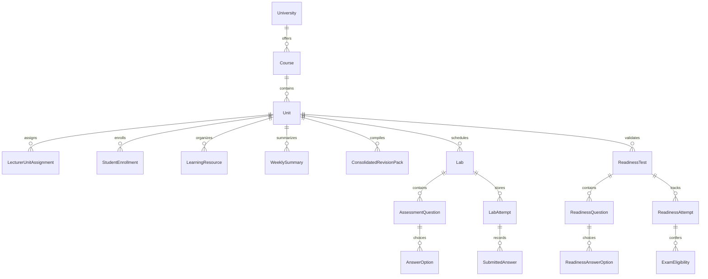

# EduShield AI — Data Model Notes

> **Database Schema, Entity Relationships & Attempt Retention Policies**
> *Prepared 16 October 2026 | Illustrative Sample / Demo Platform*

---

## 1. Relational Entity Overview

The academic domain model is encapsulated in the `academic` Django app and PostgreSQL database (`edushield_db`).

---

## 2. Core Entities & Constraints

### 2.1 Academic Hierarchy
- **`University`**: `name`, `code` (unique, e.g. `RU`), `is_demo: bool`.
- **`Course`**: `university_id`, `title` (e.g. `BSc. Software Engineering`), `code` (`BSSE`), `department`.
- **`Unit`**: `course_id`, `code` (e.g. `SE301`), `title`, `description`, `total_weeks: 14`, `is_primary_demo: bool`. Unique constraint on `(course, code)`.

### 2.2 Pedagogical Staff & Student Access Boundaries
- **`LecturerUnitAssignment`**: `lecturer_id` (FK to `users.User`), `unit_id`. Unique constraint on `(lecturer, unit)`. Lecturers can only access, upload to, or build assessments for units explicitly assigned to them.
- **`StudentEnrollment`**: `student_id` (FK to `users.User`), `unit_id`, `enrolled_at`. Unique constraint on `(student, unit)`.

### 2.3 14-Week Learning Materials
- **`LearningResource`**:
  - `unit_id`, `week_number` (1 to 14 constraint).
  - `resource_type`: `pdf` | `notes` | `slides` | `diagram` | `youtube`.
  - `file`: local uploaded asset (magic byte verified `%PDF-`).
  - `indexing_state`: `pending` | `indexed` | `failed`.
  - `is_approved_by_lecturer`: bool (default `True` when uploaded by lecturer).
- **`WeeklySummary`**:
  - `unit_id`, `week_number`.
  - `summary_text`: markdown summary.
  - `key_concepts`: JSON list of strings.
  - `is_published`: bool.

### 2.4 Consolidated Revision Pack
- **`ConsolidatedRevisionPack`**:
  - `unit_id`, `title`, `version` (e.g. `1.0`).
  - `weeks_content`: JSON structure compiling all 14 weeks of approved summaries, concepts, and key definitions.
  - `is_published`: bool.
  - *Invariant*: Shared and identical for all students enrolled in the same unit and version.

---

## 3. Assessments & Deterministic Scoring Policy

### 3.1 Lab & Assessment Structure
- **`Lab`**:
  - `unit_id`, `week_number` (1 to 14).
  - `title`, `instructions`, `total_marks: Decimal`.
  - `pass_mark: Decimal` (default 60%).
  - `requires_pass_for_completion`: bool (default `False`). In higher education workflows, completing and submitting a weekly lab counts as submission progress even if the initial score was suboptimal.
  - `scoring_policy`: `latest` | `best` | `average`.
  - `status`: `draft` | `published` | `closed`.
- **`AssessmentQuestion`**:
  - `lab_id`, `question_type`: `mcq` | `flashcard` | `written` | `practical`.
  - `question_text`, `marks: Decimal`, `topic_tag` (used for learning gap analytics).
- **`AnswerOption`**:
  - `question_id`, `option_text`, `is_correct: bool`, `explanation`.
  - *Security rule*: `is_correct` is omitted from serializers exposed to students prior to permitted feedback release.

### 3.2 Immutable Attempt Retention Policy
Student attempts are **never overwritten**. Every submission creates a new `LabAttempt` record with an incrementing `attempt_number`.
- **`LabAttempt`**:
  - `lab_id`, `student_id`.
  - `attempt_number`: auto-calculated `(max(existing) + 1)`.
  - `score: Decimal`, `max_score: Decimal`, `percentage: Decimal`.
  - `is_completed: bool` (always `True` upon valid submission).
  - `is_passed: bool` (`percentage >= pass_mark`).
  - `submitted_at`: timestamp.
- **`SubmittedAnswer`**:
  - `attempt_id`, `question_id`.
  - `selected_options`: M2M with `AnswerOption`.
  - `written_response`: text.
  - `points_awarded: Decimal`.
  - `is_correct: bool`.

---

## 4. Final Readiness Gatekeeper & Exam Eligibility

### 4.1 Server-Side Gate 1 Validation
Before a student can unlock or take the final readiness test, `calculate_unit_readiness_status()` queries the database:
1. Retrieves all published required labs for the unit (normally all 14 weeks).
2. Verifies that the student has at least one valid completed `LabAttempt` for every required week.
3. If any week is missing, the readiness test remains `locked`. Direct POST submissions are rejected with `403 Forbidden` and logged as `unauthorized_access` security violations.

### 4.2 Qualifying Threshold & Eligibility
- Qualifying threshold is deterministically set to **60%**.
- Passing records an `ExamEligibility` row:
  - `student_id`, `unit_id`.
  - `readiness_attempt_id`.
  - `status`: `eligible` | `not_eligible`.
  - `certified_at`: timestamp.
  - *Disclaimer*: Records qualification eligibility; does not claim university has granted final exam entry without authorized registrar integration.
